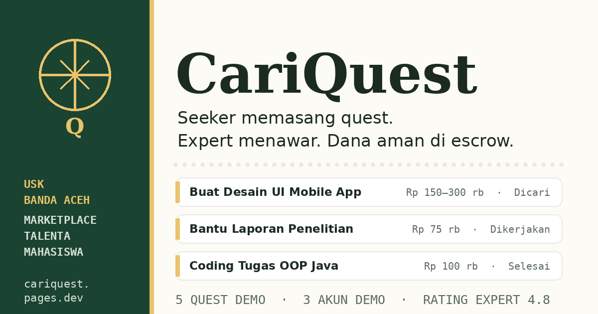

# CariQuest — Pasar Talenta Mahasiswa USK

[](https://github.com/dezzorigin/cariquest/actions/workflows/ci.yml)
[](https://flutter.dev)
[](https://dart.dev)
[](LICENSE)

**Live:** https://cariquest.pages.dev/ — **aplikasi Flutter-nya
sendiri** (`build/web` dari CI, di-deploy 19 Nov 2026 — lihat
[`docs/DEPLOYMENT.md`](docs/DEPLOYMENT.md) §3). Folder `landing/`
masih ada di repo sebagai etalase statis cadangan, tapi tidak lagi
yang di-deploy. ·
**Kode:** https://github.com/dezzorigin/cariquest

CariQuest adalah marketplace talenta kampus untuk mahasiswa
**Universitas Syiah Kuala (USK), Banda Aceh**. Seeker memasang quest —
desain UI, olah data SPSS, coding, terjemah jurnal — Expert sesama
mahasiswa menawar dan mengerjakan, dan dana dikunci di escrow sampai
Seeker menyetujui hasil. Satu papan quest, tiga peran: Seeker, Expert,
Admin.

> **Mock MVP offline 100%.** Tidak ada Firebase, server, atau API key.
> Seluruh "backend" adalah `MockData` di memori yang mensimulasikan
> database real-time. Data demo direset tiap aplikasi dijalankan ulang.



*Kartu preview di atas digambar dari data demo repo (bukan screenshot
aplikasi). Screenshot asli aplikasi + video demo menyusul — lihat
[`docs/TESTING.md`](docs/TESTING.md) § follow-up.*

## Cara jalan

```bash
flutter pub get
flutter run            # pilih perangkat (Android / Chrome)
flutter run -d chrome  # langsung ke web
flutter analyze        # linter
flutter test           # 42 tes
flutter build web --release   # → build/web
```

Tidak butuh apa-apa lagi: tanpa Firebase, tanpa akun, tanpa server.

## Akun demo (kata sandi semua: `demo123`)

| Peran | Email | Yang bisa dicoba |
|---|---|---|
| Expert | `expert@demo.com` | Bid di feed quest · dompet (saldo Rp250.000) · peringkat Skilled Worker |
| Seeker | `seeker@demo.com` | Pasang quest baru · lacak quest Working/Review/Finished |
| Admin | `admin@demo.com` | Dashboard · verifikasi pengguna · transaksi · mediasi sengketa |

Di layar login ada kartu "Demo Credentials" — ketuk salah satu baris
untuk isi otomatis. Tur 5 menit ada di
[`docs/USAGE.md`](docs/USAGE.md).

## Quest demo (data asli repo)

| Quest | Anggaran | Status demo |
|---|---|---|
| Buat Desain UI Mobile App | Rp150.000–300.000 | Mencari Expert |
| Bantu Kerjain Laporan Penelitian | Rp75.000 (final) | Sedang Dikerjakan · Urgent |
| Edit Video Presentasi Tugas Akhir | Rp100.000 (final) | Review Hasil |
| Coding Tugas OOP Java | Rp100.000 (final) | Selesai |
| Translasi Jurnal Bahasa Inggris | Rp30.000–60.000 | Mencari Expert |

Expert demo: **Aldi Firmansyah** (Informatika) — 12 quest selesai,
rating 4.8 dari 15 ulasan, skill Flutter, UI/UX, Figma, Dart.

## Lifecycle quest

```
Pending → Paid → Working → Review → Finished
   │                                  (Disputed → mediasi Admin)
   └─→ Cancelled
```

Dana dikunci di escrow sejak Paid dan baru cair ke dompet Expert
setelah Seeker menyetujui hasil (Review → Finished).

## Teknologi

| Lapisan | Teknologi |
|---|---|
| Framework | Flutter 3.x (Dart ≥3.3.4) |
| State | Riverpod 2.x (`StateNotifier` + `StreamProvider`) |
| Routing | `go_router` 13.x |
| Penyimpanan | `shared_preferences` (sesi login lokal) |
| UI | Material 3, `google_fonts` (Fraunces + Plus Jakarta Sans), `flutter_animate`, `lottie` |

## Struktur

```text
cariquest/
├── lib/            # core (tema, mock, konstanta) · features (per modul) · shared (model, route, widget)
├── test/           # 42 tes: model, data demo, widget, tema, repository
├── web/            # scaffold Flutter web (baru)
├── landing/        # etalase statis yang di-deploy ke Pages
├── docs/           # PRD · arsitektur (+ diagram) · cara pakai · testing · deploy · desain
├── scripts/        # make-og-image · advisory-sweep (OSV Pub) · check-static (gate P0 + OG)
└── e2e/            # Playwright landing (desktop + Pixel 7)
```

## Dokumen

- [PRD](docs/PRD.md) — apa yang dibangun, kenapa, dan batasan jujurnya
- [Arsitektur](docs/ARCHITECTURE.md) + [diagram](docs/architecture.html)
- [Cara pakai](docs/USAGE.md) · [Testing](docs/TESTING.md) · [Deployment](docs/DEPLOYMENT.md)
- [Kontrak desain](docs/DESIGN.md) — palet Rimba/Emas, referensi QuestDex

## Batasan jujur

- Bukan produksi: tidak ada pembayaran sungguhan (QRIS/bank/VA hanya
  pilihan di UI) dan data tidak bertahan setelah aplikasi ditutup.
- Build web Flutter hijau di CI dan sudah live sebagai aplikasi
  (bukan lagi landing — lihat [`docs/DEPLOYMENT.md`](docs/DEPLOYMENT.md) §3).
- Build Android butuh pencabutan plugin `google-services` di
  `android/app/build.gradle` (tidak ada `google-services.json` di repo
  karena mock) — build web tidak terpengaruh.

## Lisensi

MIT — lihat [LICENSE](LICENSE).
